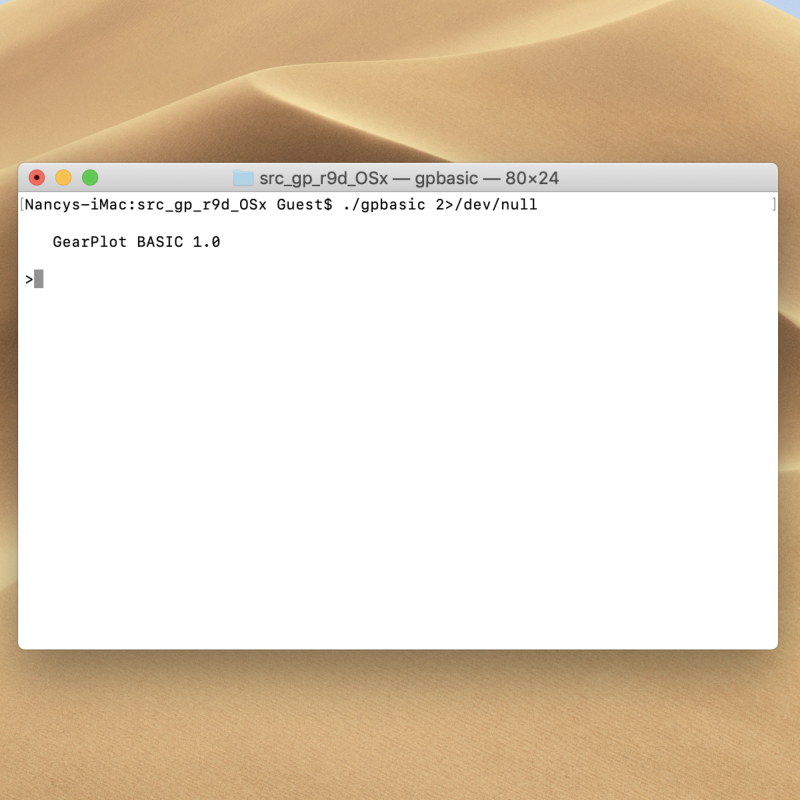
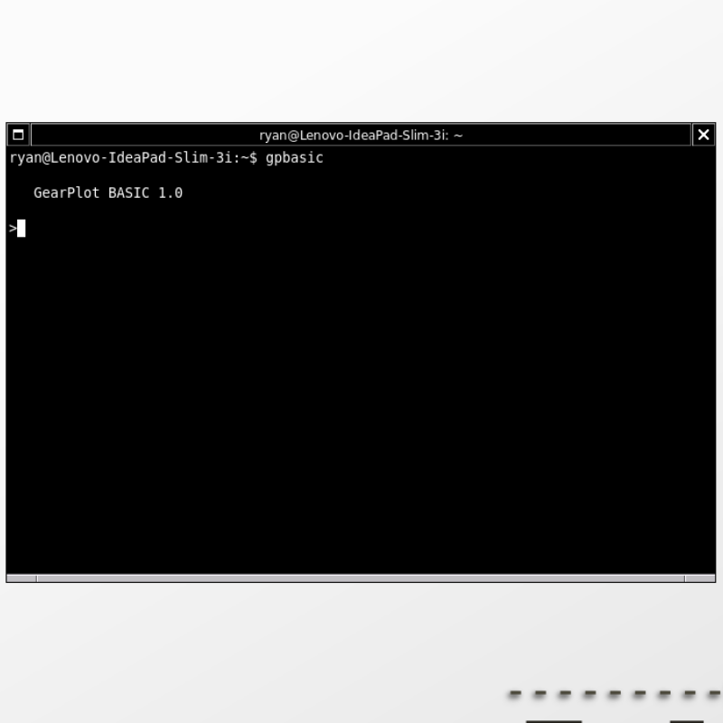
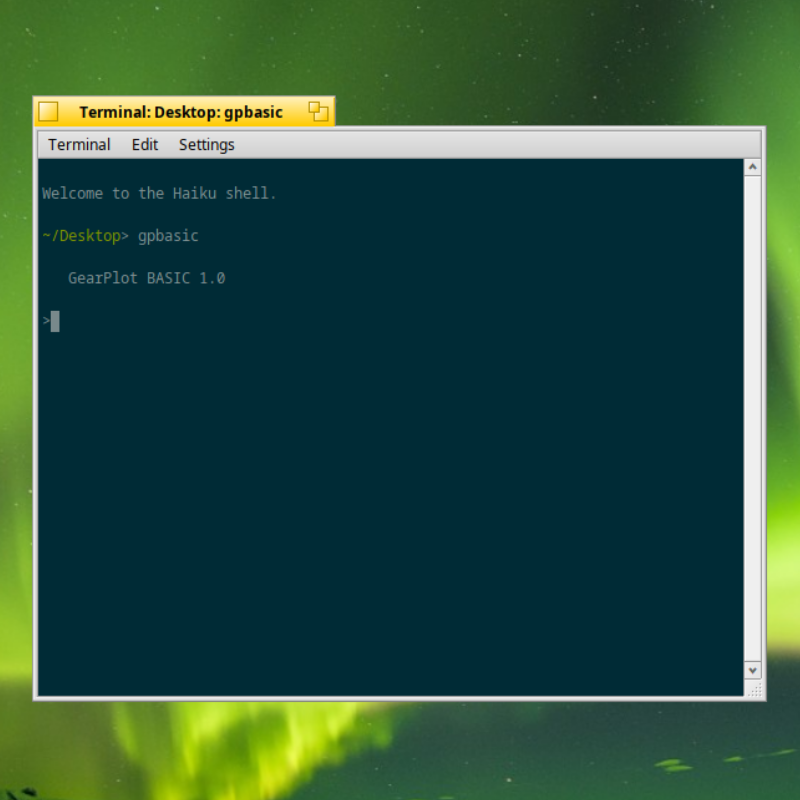
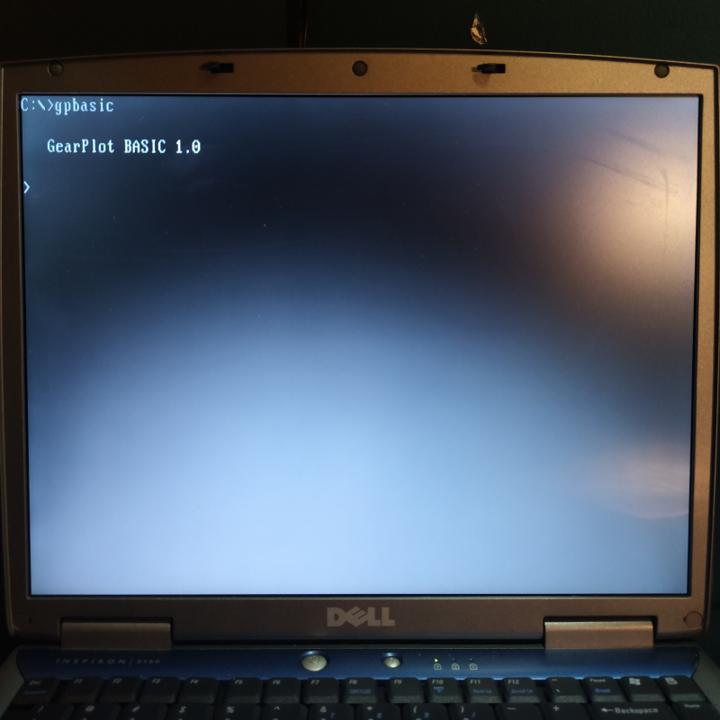
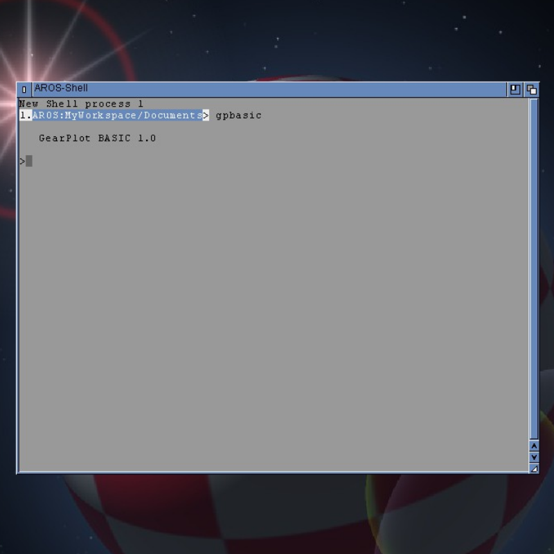

# ⚙️ GearPlot BASIC

**Portable. Powerful. Simple.**

GearPlot BASIC is a cross-platform, command-line BASIC interpreter built around the idea of *Write Once, Run Anywhere.*

Designed to make programming accessible, efficient, and practical, GearPlot BASIC combines the simplicity of traditional BASIC with an expanding set of modern capabilities.

No complicated development environments. No unnecessary boilerplate. Just write your BASIC program and run it.

The goal is simple: provide a consistent BASIC programming experience across multiple operating systems without sacrificing functionality, portability, or ease of use.

---

## 📋 Features

GearPlot BASIC originated from a public-domain BASIC script written by Dave Gillespie, originally used to test his P2C (Pascal to C) translator.

The original interpreter provided a foundation, but lacked many commonly expected BASIC features. GearPlot BASIC has since undergone extensive development, introducing new functionality and expanding its capabilities.

### ✨ Additions & Improvements

Some of the features introduced and implemented in GearPlot BASIC include:

| Feature | Description |
|---|---|
| `CLS` | Clear the screen |
| `COLOR` | Terminal text color support |
| `SLEEP` | Pause program execution |
| `INKEY$` | Read a keystroke without waiting for Enter |
| `SYSTEM` / `SHELL` | Execute operating system commands |
| `FOPEN` | Open files |
| `FCLOSE` | Close open files |
| `FPRINT` | Write data to files |
| `FREAD` | Read lines from files |
| `FEOF` | Check for end-of-file |
| `RANDOM` | Generate pseudo-random numbers |
| `RANDOMIZE` | Initialize or reset the random number generator |
| `TIMER` | Retrieve elapsed seconds since midnight |
| `INT` | Calculate the mathematical floor of a numeric expression |
| `LEFT$` | Returns a substring containing the first (leftmost) |
| `RIGHT$` | Returns a substring containing the last (rightmost) |
| `INSTR` | locates the position of a substring within a larger string. |
| `UCASE$` | Lowercase alphabetic characters converted to uppercase. |
| `LCASE$` | Uppercase alphabetic characters converted to lowercase |

Additional improvements include:

- Fixed `GOTOXY` it was in the original script but did not work.
- Direct command-line execution of BASIC scripts.
- Expanded file input/output capabilities.
- Improved terminal interaction.
- Additional functionality beyond the original interpreter.

---

## 💻 Supported Operating Systems

GearPlot BASIC is designed to be cross-platform, with portability being a fundamental part of the project.

The following operating systems have been successfully compiled and tested:

- **macOS**
- **Linux** – 32-bit and 64-bit
- **DOS**
- **Haiku OS** – 32-bit and 64-bit
- **AROS** – ABIv0, 32-bit

### ⚠️ Experimental / Unsuccessful Platforms

The following operating systems have been tested, but GearPlot BASIC did not function correctly:

- **ReactOS** – The DOS version launched, but further interaction and program execution were unsuccessful.
- **KolibriOS** – The interpreter compiled and launched, but could not be used successfully.

These platforms may be revisited in future development.

---

## 🛠️ Development Progress

GearPlot BASIC remains an actively developed project, currently on its **10th revision**.

Every revision has been developed through a hands-on, incremental process. I personally modify the interpreter's source code, introducing a small number of new features, improvements, or fixes at a time.

Rather than making large batches of changes and hoping everything works, each revision goes through an extensive testing process:

- Source code modifications are made individually and incrementally.
- The interpreter is compiled on every supported and functional operating system.
- Each working platform undergoes repeated testing to verify functionality and identify potential issues.
- New features and existing functionality are tested repeatedly to help maintain consistency across platforms.

This approach allows me to carefully monitor changes, identify problems early, and maintain compatibility across the various operating systems GearPlot BASIC supports.

**GearPlot BASIC is developed and maintained single-handedly, with a strong emphasis on reliability, consistency, and cross-platform compatibility.**

Every revision is another step toward the goal of building a truly portable, powerful, and simple BASIC programming language.

---

## 📸 Screenshots

A look at GearPlot BASIC running across several supported platforms.

https://github.com/user-attachments/assets/48d7d831-3c63-4bca-b965-71ed85cd3744

| macOS | Linux |
|:---:|:---:|
|  |  |

| Haiku OS | DOS |
|:---:|:---:|
|  |  |

| AROS |
|:---:|
|  |

**[View More Screenshots](https://github.com/GearPlot/gpbasic/tree/main/screenshots)**

---

**GearPlot BASIC**

*One language. Multiple platforms. No unnecessary complexity.*
 
 
